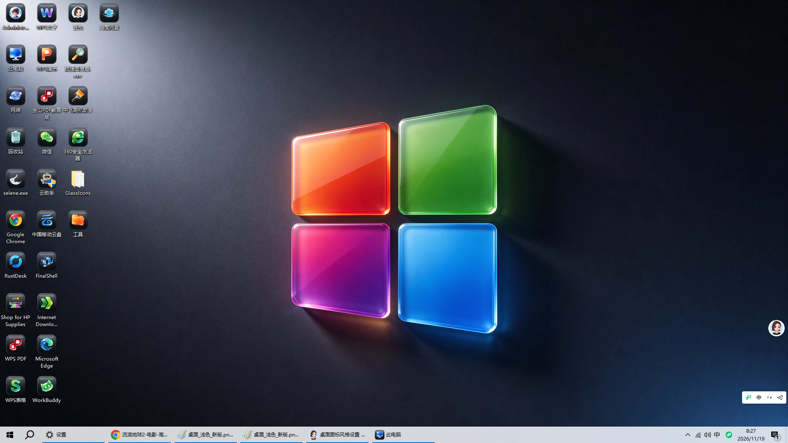
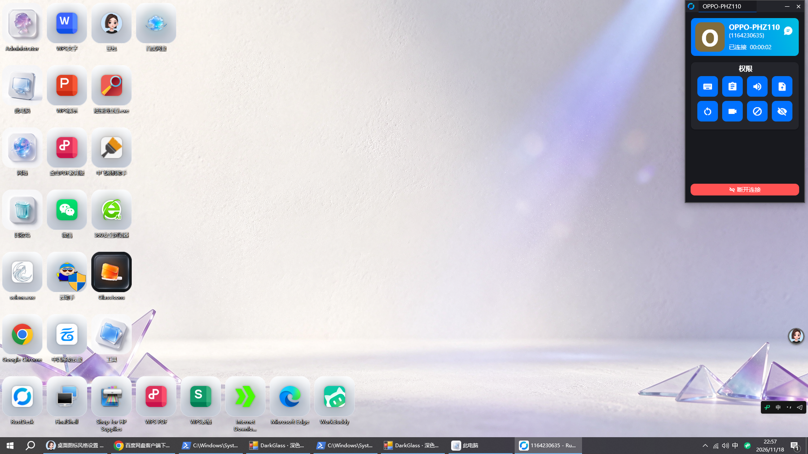
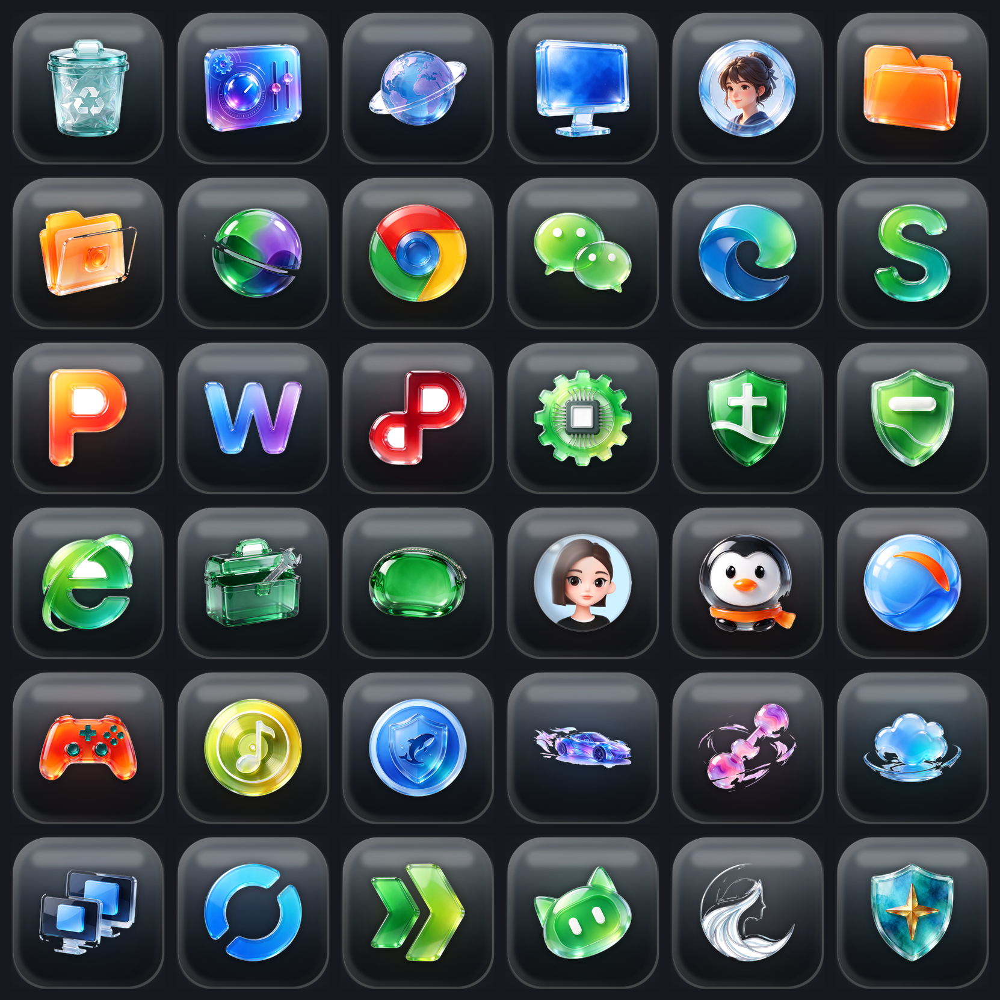
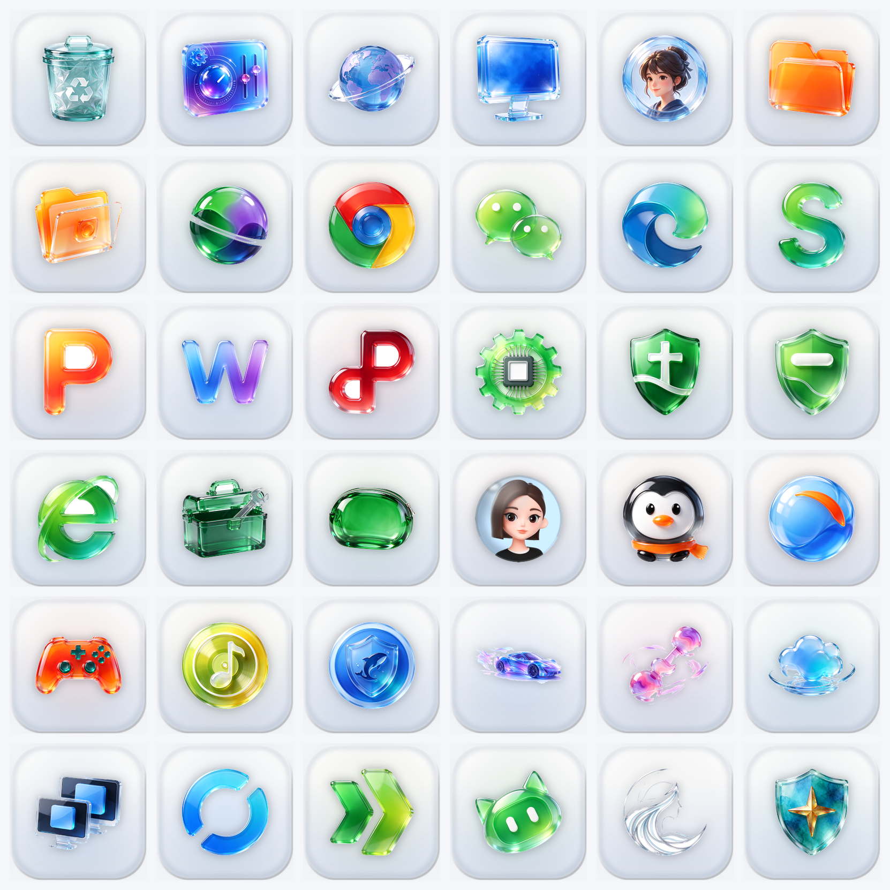
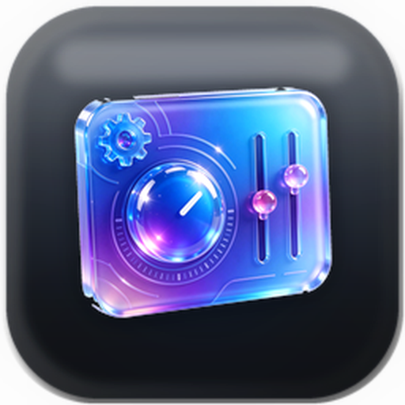
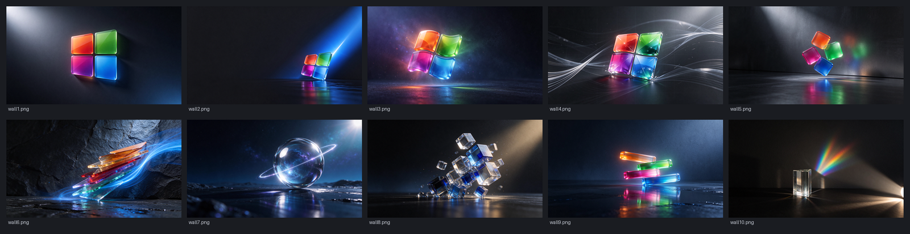
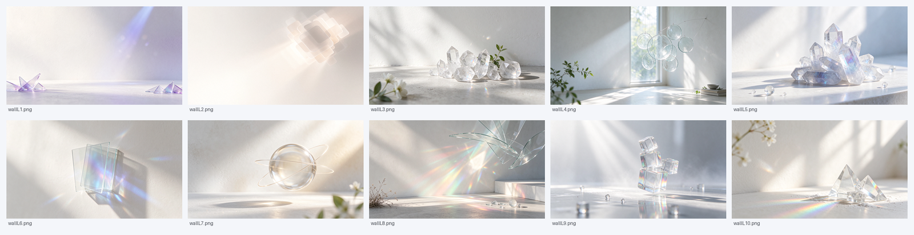

# GlassDesk · 双色玻璃桌面主题

> 为 Windows 10 / 11 桌面打造的「磨砂玻璃圆角底板 + 彩色玻璃徽标」图标主题，深色、浅色两套一键切换，单文件程序即装即用。


仓库：<https://github.com/sammaosamsam/GlassDesk>

```powershell
git clone https://github.com/sammaosamsam/GlassDesk.git
```

---

## 效果预览

| 深色 | 浅色 |
| --- | --- |
|  |  |

## 高清图标预览

**深色一套（311 个映射）**



**浅色一套（311 个映射）**



单枚特写：

| 豆包（深 / 浅） | 控制面板（深 / 浅） |
| --- | --- |
|   |   |

## 壁纸

**深色系 10 张**



**浅色系 11 张**



---

## 特性

- **一套底板，两套配色**：乳白立体（浅色）与深空玻璃（深色），图标底板同一套几何参数，切换时不会出现「风格断层」。
- **贴边圆角投影**：投影跟随底板自身的 squircle 轮廓偏移生成，再用 `MaxFilter` 收边、顶部渐隐清零，做到「阴影贴着图标、不往四角发散」。
- **玻璃倒角结构**：底板内侧一圈斜边，上半提亮、下半压暗，形成「光从上方来、板有厚度」的立体感。
- **全链路覆盖**：桌面快捷方式、公共桌面、系统图标（此电脑 / 网络 / 回收站 / 用户文件夹 / 控制面板）、文件夹图标、快捷方式小箭头、壁纸一起处理。
- **文件夹不再变缩略图**：写 `desktop.ini` 自定义图标 + 关闭文件夹缩略图，塞满快捷方式的文件夹也保持统一图标。
- **控制面板也能换**：该图标属于系统命名空间，注册表键归 TrustedInstaller 所有，管理员也改不动，因此采用「隐藏系统项 + 同名 `control.exe` 快捷方式挂玻璃图标」的方案。
- **一键还原**：把快捷方式图标、系统图标、文件夹图标、小箭头、壁纸、缩略图设置全部恢复原样。
- **单文件绿色版**：一个 exe，双击即用，资源自解压到 exe 同级的 `GlassDesk_data\`，换机器不留痕。

## 快速开始

### 方式一：直接用（推荐）

从 [Releases](../../releases) 下载 `GlassDesk.exe`，放到任意目录双击运行：

1. **一键安装** — 图标 + 系统图标 + 文件夹图标 + 去小箭头 + 壁纸 + 重建缓存（需一次管理员授权）
2. **深色风格 / 浅色风格** — 只切图标 + 系统图标 + 文件夹图标 + 壁纸，立即生效
3. **一键还原** — 全部恢复系统默认

> 运行后会在 exe 同级生成 `GlassDesk_data\`（图标、壁纸、界面脚本）。删除该目录不影响已应用的图标，但再次切换主题需要它。

### 方式二：从源码构建

需要 Windows 10/11、Python 3.9+、PyInstaller 6.x：

```powershell
pip install pyinstaller pillow
cd src
python -m PyInstaller --noconfirm --onefile --windowed --name GlassDesk `
  --icon ..\assets\icons\sys_cpl.ico `
  --add-data "..\assets;assets" `
  --distpath ..\dist --workpath ..\build --specpath . launch.py
```

产物在 `dist\GlassDesk.exe`。

## 目录结构

```
GlassDesk/
├─ assets/
│  ├─ icons/               # 477 个 .ico（深 233 + 浅 233 + 系统/文件夹/空白）
│  ├─ wallpapers/          # 深色 wall1-10、浅色 wallL1-L11（1920×1080）
│  ├─ install_config.json  # exe→图标映射 311/311、系统图标 5/5、文件名表
│  └─ theme_ui.ps1         # WinForms 界面与全部应用逻辑
├─ src/
│  ├─ launch.py            # exe 入口：展开资源 → 拉起 PowerShell 界面
│  └─ installer.py         # 资源解压（exe 同级优先）、提权、壁纸、重启资源管理器
├─ tools/                  # 图标生成与合成脚本（见下）
└─ docs/images/            # README 预览图
```

## 技术实现

### 图标底板

| 参数 | 浅色 | 深色 |
| --- | --- | --- |
| 底板渐变 | `#FFFFFF → #E8EEF8` | `#343A44 → #101318` |
| 倒角 | 上白 62% / 下灰蓝 30% | 上白 62% / 下黑 55% |
| 顶部柔光 | 48 | 44 |
| 高光条 | 80 | 66 |
| 底部内阴影 | 22 | 44 |
| 图标内边距 `INSET` | 4 | 4 |
| 徽标占比 `LOGO_RATIO` | 0.66 | 0.66 |
| 投影 | 底板自身 mask 偏移 + 高斯模糊 1.2% + MaxFilter 7 收边 + 顶部渐隐 | 同左 |

相关脚本：`tools/plate_v6.py`（底板）、`tools/retheme_v5.py`（合成）、`tools/compose_icons.py`（squircle mask / 取色 / 导出多尺寸 ico）。

### 系统图标替换

- 快捷方式：读取 `TargetPath` 的 exe 名查表（大小写不敏感），未命中时按当前图标路径做 `l_` 前缀互换；无 `TargetPath` 的快捷方式按显示名兜底（如 微信、控制面板）。
- 命名空间图标（此电脑 / 网络 / 回收站 / 用户文件夹）：写 `HKCU\Software\Microsoft\Windows\CurrentVersion\Explorer\CLSID\{GUID}\DefaultIcon`。
- 控制面板：`HKLM\...\CLSID\{21EC2020-…}\DefaultIcon` 属 TrustedInstaller，管理员也无法写入 → 隐藏命名空间项（三个相关 GUID）+ 桌面放同名 `control.exe` 快捷方式。
- 文件夹：`HKLM\...\Explorer\Shell Icons` 的 3/4（文件夹）/29（小箭头），以及每个桌面文件夹的 `desktop.ini`。
- 图标尺寸：重启资源管理器前后记录并写回 `Bags\1\Desktop\IconSize`，不改动用户原有尺寸。

## 已知限制

- 控制面板采用「同名快捷方式」方案，图标是玻璃版，但它是普通快捷方式，不是系统命名空间项。
- 关闭文件夹缩略图是系统级设置（「始终显示图标，从不显示缩略图」），因此图片文件也不再显示缩略图；一键还原会写回原设置。
- 仅处理桌面层级，开始菜单磁贴与 UWP 应用图标不在范围内。
- 新装的软件若不在映射表内，会走「按现有图标路径切换」兜底；需要玻璃图标可以在 `assets/install_config.json` 里加一行。

## 致谢与声明

- 图标中的品牌徽标版权归各自厂商所有，本项目仅做风格化重绘用于个人桌面美化。
- 主题会修改注册表与桌面快捷方式图标，请自行评估风险；使用「一键还原」可恢复。

## License

[MIT](LICENSE)
